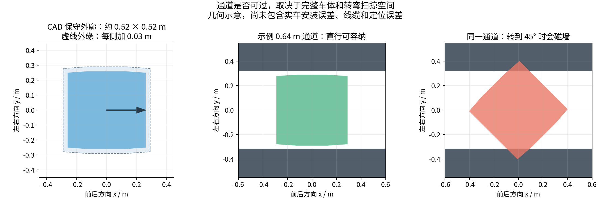

# 独立底盘：双雷达建图与点到点导航

面向 Ubuntu 24.04 / ROS 2 Jazzy / x86_64 NUC 的研发项目。包含手柄与 CAN 底盘控制、双 MID360S 标定和融合、PTP 时间监测、FAST-LIO-SAM 回环与因子图后端、URDF 车体显示及 Nav2 点到点导航候选。

**当前版本：2026-11-27 研发整理版，尚未完成自主导航实车验收。** 原调试目录不受影响；这里是独立整理的源码项目，不是直接覆盖原 NUC 的部署包。

## 从这里开始

- [项目总览、模块边界与数据流](docs/engineering/architecture.md)
- [研发说明：算法原理与代码索引](docs/engineering/development.md)
- [安装、编译及离线验证](docs/guides/build.md)
- [实验操作顺序与验收](docs/guides/experiments.md)
- [外部数据、CAD 与备份](docs/guides/data.md)
- [当前验证状态与已知问题](docs/STATUS.md)
- [Git 上传、协作与版本管理](docs/guides/git.md)
- [来源、第三方授权与依赖](THIRD_PARTY_NOTICES.md)
- [历史记录与周报索引](docs/history/README.md)

## 能力状态

| 能力 | 已有依据 | 本仓库的边界 |
|---|---|---|
| 手柄前后、横移、旋转、物理急停 | 原系统用户实车确认；控制源码及映射记录已收录 | 新目录重新编译后仍需目标 NUC 联调 |
| 双雷达相对外参 | A/B 训练与独立 D 复核，RMSE 20.136 mm | 雷达到车体锚点、地面差异仍未验收 |
| 双雷达移动建图 | 2026-11-26 实车 311.11 s，累计导出 14,160,514 点 | 那次运行没有开启 SAM/回环 |
| 回环与 iSAM2 优化 | 本机合成轨迹：17 关键帧、1 条实际回环因子 | 真实 rosbag 回放、闭环路线待验证 |
| 车体形状与占据空间 | CAD 包络约 0.520 × 0.520 × 0.326 m，旋转扫掠碰撞测试 | CAD 与现车安装、突出线缆及近场障碍待核对 |
| 地图点选目标、Nav2 控制接入 | 页面与门禁离线测试；规划/定位/控制配置齐备 | 自主到点、取消、窄通道均未实车验收，默认门禁关闭 |

合成测试结果不能替代实车验收。`config/acceptance.json` 保留未通过状态。

## 目录

```text
chassis-autonomy/
├── control/                 # SocketCAN、轮组运动学、控制桥、手柄（含上游升降兼容代码）
├── calibration/             # 静止采集、双雷达几何标定、独立验证、低速移位入口
├── sensors/                 # 真正的 Livox SDK2 与 ROS2 驱动源码
├── timing/                  # PTP 抓包和诊断解析工具
├── recovery/                # 雷达启动扫描故障检测与有限次自动重启
├── mapping_trial/           # 当前双雷达融合、前端输入、原始时间监测、运动许可
├── mapping_ws/src/fast_lio_sam/ # FAST-LIO 前端与回环、iSAM2 后端
├── config/                  # 当前 Nav2 / 定位 / 验收配置
├── model/                   # 原始 CAD 文本、轻量 URDF、包络与全模型引用
├── scripts/                 # 构建、回放、地图导出、定位、地图网页、导航监督
├── launch/  rviz/           # ROS2 启动与显示
├── tools/                   # 整理后新增：自检、资产导入、源码传输
├── deployment/              # 网络、CAN/PTP 参考和旧部署入口说明
├── tests/                   # 几何与门禁测试、合成轨迹和网页测试
├── evidence/  reports/      # 实车证据摘要 / 历史本机测试报告与图片
├── research/               # 历史实验脚本、基线与复核；不作为新入口
├── docs/                   # 研发、操作、周报、历史记录
├── provenance/             # 导入来源与文件哈希
└── assets/manifest.json     # 大文件清单；assets/local/ 被 Git 忽略
```

## 不接硬件也可验证

建议克隆到英文无空格路径，如 `/home/pc/chassis-autonomy`。当前本机同名路径是指向整理目录的快捷链接。

```bash
cd /home/pc/chassis-autonomy
python3 tools/prepare_workspace.py
python3 tools/check_repository.py
python3 tools/test_offline.py
bash control/build.sh
# 已有 ROS Jazzy 和 GTSAM 时，可仅构建消息与 SLAM，不运行雷达：
bash scripts/build_sam.sh --local-message-only
```

`--local-message-only` 只是离线构建辅助；真正采集必须构建 `sensors/` 中的完整驱动，详见编译指南。



## 项目范围

目标是**双雷达建图 → 保存地图 → 已知地图定位 → 用户标点 → 底盘到点**。当前不要求多点巡航。2D footprint 用于地面路径碰撞检查，并不证明能通过任意低矮横梁或三维狭缝。轮式底盘支持横移，但当前全局规划是 Smac Hybrid，并非完整全向运动格搜索。

本项目没有统一追加开源许可证；已有第三方声明原样保留，未知授权项见来源说明。Git 远端尚未配置。
