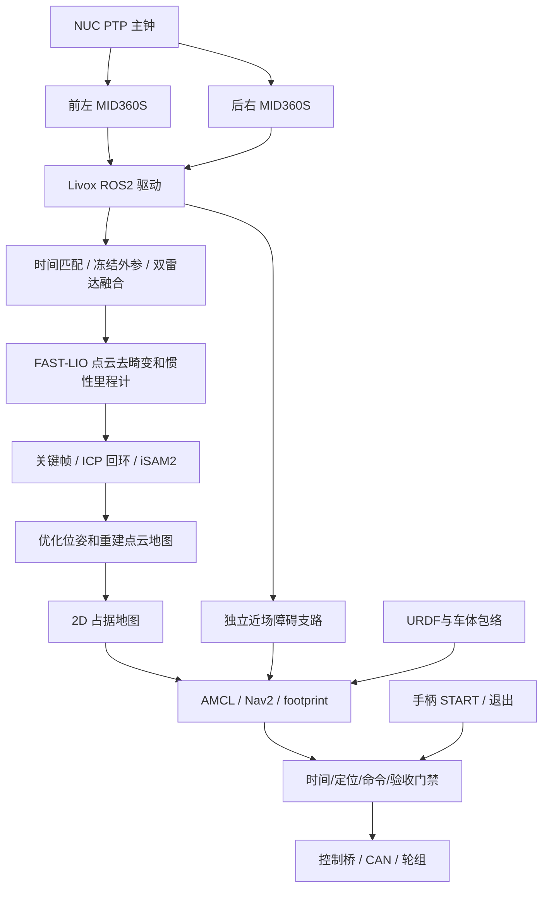

# 系统架构与接口

## 硬件和进程

NUC 连接 PEAK USB-CAN 和手柄，通过交换机连接两台独立供电的 MID360S。外置 YESENSE 串口 IMU 与雷达内置 IMU 是不同设备；当前 FAST-LIO 使用后右雷达内置 IMU。CAN 是控制总线，PTP 是以太网时间同步，两者不可混用。

地图显示由 `scripts/map_console.py` 提供，默认只读、监听本机。目标模式带显式发送/取消操作。网页可以显示模型的二维包络；完整三维车体由 RViz + robot_state_publisher 显示。

## 两种互斥运行模式

| 模式 | 地图与定位来源 | TF 责任 |
|---|---|---|
| 建图 | FAST-LIO + SAM 后端 | `trial_map → trial_odom → trial_slam_imu_159 → base_link_trial` |
| 已知地图导航 | FAST-LIO 连续里程计 + AMCL 全局定位 | AMCL 发布 `map → trial_odom`；前端仅发布里程计到 IMU |

导航前端 `sam_enable=false`、`publish/map_to_odom_tf_en=false`，避免 AMCL 和 SAM 同时争夺全局 TF。车体显示还挂 `base_link_trial → chassis_model_base`；当前该连接为待核对的单位变换，不能视为真实测量。

地图建图和已知地图导航不能同时运行。切换时应正常退出前一个监督进程并检查 ROS 节点、锁和硬件句柄释放。

## 配置责任

| 文件 | 内容 | 修改后需复核 |
|---|---|---|
| `mapping_trial/config/devices.json` | IP、MAC、主题和身份 | 设备来源、四路数据、时间 |
| `mapping_trial/config/dual.json` | Livox 主机地址和驱动参数 | 收包、驱动外参保持零 |
| `mapping_trial/config/extrinsics_active.json` | 相对变换和车体锚点 | 坐标轴方向、D 组残差、地面 |
| `mapping_trial/config/lio.yaml` | IMU/雷达变换、前端、回环 | 去畸变、闭环误检、地图导出 |
| `model/body_geometry.json` | CAD 包络和 footprint | 当前机械外形、旋转扫掠 |
| `config/nav2.yaml` | AMCL、代价地图、规划器、控制器 | 重定位、障碍、规划取消 |
| `config/acceptance.json` | 配置哈希和现场验收证据 | 每次涉及几何/导航配置修改 |

网络与设备参数是当前底盘配置，不是任意底盘通用常量。换传感器时需同时核对标定 settings、driver、devices、dual 与时间监测脚本，不可只改一处 IP。

## 运动指令的最后一跳

`navigation_motion.py` 监督导航健康和验收，写入带 boot_id、session、单调时间的许可与命令；`guarded_remote.py` 校验新鲜度、有限数值和速度，再交给 `control/program/remote/bridge.cpp`。

候选导航速度限制为平移合速度 ≤0.05 m/s、角速度 ≤0.04 rad/s。许可 250 ms、底层输入看门狗 300 ms；命令丢失或会话不匹配必须停止。仍需操作者 START，使能不是程序启动的副作用。独立底盘入口不启用升降。

## 设备现状

| 部件 | 当前标识 |
|---|---|
| 前左雷达 | 192.168.1.132 / BDLCN9S0039449 / 0c:9a:e6:62:6b:ef |
| 后右雷达 | 192.168.1.159 / ARMCP9M0033988 / 34:91:f0:e6:fe:29 |
| NUC 雷达网卡 | enp85s0，192.168.1.4/24；旧地址 192.168.16.4/24 保留 |
| NUC SSH | pc@10.23.2.190（Wi-Fi DHCP 地址可能变化） |
| CAN | can0，经典 CAN 1 Mbps，RS02 ID 1–4 |

NUC 作为软件 PTP 主钟；MASTER 只能证明主钟状态，不能独立证明两台雷达实际数据已经同步。
