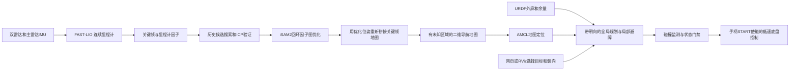

# 双雷达回环建图、车体轮廓与点到点导航

2026-11-27。**当前为独立接入版本：本机编译和合成数据测试通过，尚未部署到目标 NUC，未进行实车自主导航验收。** 目标 `pc@10.23.2.190` 当前 SSH 不可达。原来已调通的遥控、标定外参和建图目录没有修改。

本机目录：`/home/pc/文档/ChatGPT/底盘调试/回环与自主导航接入_20261127`。为兼容本机 ROSIDL 对中文路径的处理，另建同目录链接 `/home/pc/chassis_integration_20261127`。目标 NUC 将使用这个英文路径作为独立安装目录。

## 1. 三部分怎样连接



建图和已有地图导航分为两个运行模式，不能同时启动。建图时 FAST-LIO-SAM 发布 `trial_map → trial_odom`；导航时禁止该发布，由 AMCL 发布 `map → trial_odom`。两种模式都保留连续的 `trial_odom → trial_slam_imu_159 → base_link_trial`，速度控制不跟随回环产生的全局位置跳变。

## 2. 已完成与验证边界

| 部分 | 已完成 | 验证范围 |
|---|---|---|
| 回环后端 | 启用 SAM 和回环；限制候选时间、重叠率和校正幅度；逐次运行导出 | 本机 C++ 编译通过；合成闭合路线产生 17 个关键帧、1 条实际回环因子、34,000 点优化地图 |
| 导出 | 优化后的关键帧位姿、完整关键帧拼接 PCD、回环审计记录、二维栅格 | 合成地图导出通过；没有拿旧的累计点云冒充优化地图 |
| 车体形状 | URDF 网格、joint、visual origin、scale 全部参与计算；车轮用整圈转动包络 | 保守 CAD 外廓约 0.5200 × 0.5198 × 0.3261 m；尚未实测安装关系和线缆突出量 |
| 碰撞几何 | 凸多边形、3 cm 初始余量、转弯扫掠、未知区域拒绝 | 12 项几何和指令门禁测试通过；包括“端点安全但中途转弯碰墙” |
| 地图显示 | 网页底盘轮廓；RViz 原始 STL/轻量代理模型；优化地图、轨迹、回环边 | 浏览器合成数据显示和只读接口拒绝测试通过；RViz 现场未验证 |
| 定位 TF | FAST-LIO 导航模式不发布 map→odom，给 AMCL 独占 | 合成测试收到 97 条里程计并核对 TF 所属关系 |
| 点到点导航 | Nav2 配置、网页/RViz/命令行目标入口、取消、独立低速硬件桥 | 候选代码完成；本机缺 Nav2/AMCL/Smac/DWB/RViz 运行包，规划控制器和实车未联调 |

所有合成测试均未启动 CAN 或电机。`reports/` 中保留日志和结果。合成图不是这台底盘的真实环境地图，不能用于实际行驶。

## 3. 车体外形与通道宽度


模型外廓来自每个零件变换后的保守包围盒，并考虑连续车轮关节的完整转动。计算没有把 STL 原始坐标或雷达 link 原点直接当作车体外廓/光学中心。

当前按 CAD 的 `-Y` 对应车前、`+X` 对应车左生成 ROS 模型，模型中心暂与 `base_link_trial` 重合。**这个对应仍是候选**：现有雷达到车体关系采用旧 CAD 后右锚点，新 URDF 没有提供已验证的光学中心和 IP/SN 对应，不能自动替换雷达标定结果。

每侧 3 cm 是初始试验余量，所以直行所需几何宽度约 58 cm；这不是“58 cm 通道一定能过”的承诺。栅格分辨率、定位偏差、地图误差、轮胎/线缆突出和转弯时的扫掠范围都需要计入。没有可靠观测的未知区域禁止通过。

当前全局规划采用 Smac Hybrid A*，会考虑位置和朝向下的多边形；局部控制保留 DWB 横移能力及 ObstacleFootprint 检查。全局搜索先使用保守的前进/后退曲线，最小转弯半径 1.25 m，**尚不是充分利用全向横移的 lattice 规划器**。因此可能拒绝某些实车横移能够通过的空间；不会声称已找到所有可行的窄通道路线。

当前是平地二维导航。低障碍高度带初值为离模型地面约 2 cm 至车顶上方 5 cm；贴地小物体、台阶和上下方通行净空需要另行验证，二维轮廓不能证明三维通行安全。

## 4. NUC 连通后的部署和真实回放

在本机先部署独立目录（只复制、生成模型、编译，不启动服务或电机）：

```bash
bash /home/pc/chassis_integration_20261127/scripts/deploy_to_nuc.sh
```

脚本拒绝覆盖已存在的目标目录，失败后保留现场；若部分传输失败，应先检查该目录再补传，不能直接删除已有记录。目标端编译使用已部署的真实 Livox 驱动依赖；本机 `build_support/livox_ros_driver2` 仅用于编译消息接口，不提供硬件驱动。

目标 NUC 上先执行环境检查：

```bash
source /home/pc/chassis_integration_20261127/scripts/env.sh
python3 /home/pc/chassis_integration_20261127/scripts/check_environment.py
```

缺包时，在目标 NUC 核对后安装 ROS Jazzy `navigation2`、`nav2-bringup`、`rviz2`（命令需 sudo）。缺少运行包和未完成现场验收会使检查返回 2；这不是编译错误。

优先回放已保存的 11 月 26 日真实数据，不先动车：

```bash
python3 /home/pc/chassis_integration_20261127/scripts/replay_sam.py \
  /home/pc/motion_mapping_trial_20261126/runs/20261126_145615/bag
```

回放默认 ROS domain 72，只播放 `/slam/points` 和 `/rear_right/imu`，不播放旧 TF、不启动驱动和控制器。输出在 `replay_runs/时间/optimized/`，需要检查 `report.json`、回环边是否合理以及墙面是否重合。此前路线首尾相距约 0.237 m 并不等同于真实闭环误差；是否确实返回同一位置仍需依据现场轨迹确认。

参数候选在 `mapping_trial/config/lio.yaml`：关键帧间距 0.3 m 或转角 0.15 rad；历史时间隔离 30 s；检索半径 2 m；ICP 对应上限 0.5 m；匹配均方距离上限 0.04 m²；0.2 m 内源点覆盖率至少 60%；相对初值的校正不超过 0.5 m / 0.35 rad。不是通用最优参数。重复结构仍可能误匹配，新增检查不能替代真实回环审阅。

主要结果：

- `KEY_FRAMES/global.pcd`：用最终优化 IMU 位姿拼接的地图。
- `KEY_FRAMES/keyframe_pose.txt`：最终 IMU 位姿；角度为 roll/pitch/yaw 弧度。
- `KEY_FRAMES/scans/`：原始雷达系去畸变关键帧；导出时必须乘雷达到 IMU 外参。
- `graph_poses.csv`：前端位置与优化位姿，用于比较校正。
- `loop_candidates.csv`：时间、当前帧、历史帧、ICP均方距离、源点覆盖率、校正平移、校正角度、是否通过几何检查；不包含在更早 ICP 收敛检查中拒绝的候选。
- `loop_factors.csv` / `graph_summary.json`：入图回环边和最终更新统计。

`loop_factors=0` 只表示没有接受回环，不能把“功能开启”写成“回环成功”。

## 5. 下一次双雷达实车建图

维持已经验证的交换机双雷达接法和原有时间监测。目标 NUC 上原始监测需独立终端运行：

```bash
sudo python3 /home/pc/motion_mapping_trial_20261126/raw_time_monitor.py --seconds 3600
```

先运行静止检查，再由操作员启动低速窗口；两条命令分两轮执行：

```bash
/home/pc/chassis_integration_20261127/mapping_trial/start_mapping.sh --seconds 90
/home/pc/chassis_integration_20261127/mapping_trial/start_mapping.sh --motion --seconds 900
```

仍由手柄 START 使能，双扳机退出，平移上限 0.05 m/s、转向 0.04 rad/s。初始化时静止；沿闭合路线返回可辨识的起点附近，停留数秒让回环线程处理，再退出。运行结束自动验证优化导出。原始时间监测故障、双雷达丢失或里程计异常仍会收回运动许可。

原建图的每雷达 1 m 近场过滤暂时保留，以避免在回环接入时同时更改已测通的前端；**其累计预览 PCD 不能直接当作可靠近距离障碍图**。本版导航障碍输入另从两台雷达原始点云取得，使用候选车体自过滤，尚需验证误删和近场覆盖。

## 6. 显示优化地图和真实车体尺寸

目标 NUC 上开启默认只读网页：

```bash
source /home/pc/chassis_integration_20261127/scripts/env.sh
python3 /home/pc/chassis_integration_20261127/scripts/map_console.py
```

本机另开 SSH 隧道：

```bash
ssh -N -L 18766:127.0.0.1:18766 -i /home/pc/.ssh/id_ed25519_chassis_nuc pc@10.23.2.190
```

浏览器打开 `http://127.0.0.1:18766`。服务仅绑定回环地址。网页每次替换优化关键帧地图，不叠加校正前的旧地图；蓝色多边形来自完整车体外廓，位置来自车体 TF，不再仅画主 IMU 的位置三角形。当前模型安装关系未核实的提示会保留。

有桌面或可用远程显示时，RViz 可看原始 STL 模型：

```bash
ros2 launch /home/pc/chassis_integration_20261127/launch/display.launch.py full_mesh:=true
```

精细模型约 944 万三角面，资源占用较大；默认 `full_mesh:=false` 使用与保守包络对应的轻量模型。车轮显示暂为零角度，不是假定读取到了编码器。导航时另加 `fixed_frame:=map`。

## 7. 导出供导航使用的地图

在优化地图中确认地面高度，然后设置本次输出路径和真实 `floor_z`。不能假定地图的 z=0 就是地面，LIO 初始原点靠近 IMU。

```bash
python3 /home/pc/chassis_integration_20261127/scripts/export_navigation_map.py \
  /home/pc/chassis_integration_20261127/replay_runs/本次运行/optimized \
  --lio-config /home/pc/chassis_integration_20261127/mapping_trial/config/lio.yaml \
  --floor-z 实际地图地面高度 \
  --output /home/pc/chassis_integration_20261127/maps/本次地图
```

这是命令模板，需替换“本次运行 / 实际地图地面高度 / 本次地图”。脚本使用最终优化位姿和雷达外参逐帧投影、沿观测射线记录空闲，不把点云包围框内的所有区域都填成空闲；1 m 建图盲区内不凭空清空障碍。输出 PGM/YAML 及可检查的 NPZ，目录必须新建。初始分辨率 2.5 cm。投影高度带要和实车地面、车体高度核对。

## 8. 已有地图上的选点导航

这一节是待实车联调的入口，当前不能宣称已经可用。先停止建图和任何遥控控制器，原始时间监测继续运行。

目标 NUC 终端一：只启动传感器和连续里程计，不启动电机：

```bash
source /home/pc/chassis_integration_20261127/scripts/env.sh
python3 /home/pc/chassis_integration_20261127/scripts/run_localization.py --seconds 1800
```

终端二：启动 Nav2、地图和 AMCL（替换地图路径）：

```bash
source /home/pc/chassis_integration_20261127/scripts/env.sh
ros2 launch /home/pc/chassis_integration_20261127/launch/navigation.launch.py \
  map:=/home/pc/chassis_integration_20261127/maps/本次地图/map.yaml
```

先用 RViz 的 **2D Pose Estimate** 提供当前大致位置/朝向，核对扫描与墙体是否一致。网页目前不提供初始定位操作；只有 SSH 时可用 ROS `/initialpose` 命令由调试人员根据实际地图坐标发送，不能随意填 0,0。不做无初始位置的自动全局定位承诺。

终端三：检查独立运动门禁，默认不会启动 CAN：

```bash
source /home/pc/chassis_integration_20261127/scripts/env.sh
python3 /home/pc/chassis_integration_20261127/scripts/navigation_motion.py --seconds 60
```

终端四：网页选点入口（沿用上一节 SSH 隧道）：

```bash
source /home/pc/chassis_integration_20261127/scripts/env.sh
python3 /home/pc/chassis_integration_20261127/scripts/map_console.py --navigation --allow-goals
```

在地图上按住、拖动以选择目标和最终朝向，点击“发送选定目标”；“取消导航”请求取消当前动作。网页先检查目标处整个车体是否碰障碍/未知区域；沿途规划由 Nav2 完成。RViz 的 **Nav2 Goal** 或命令行也可发送同一个 action：

```bash
python3 /home/pc/chassis_integration_20261127/scripts/send_goal.py 1.2 0.5 --yaw-deg 90
python3 /home/pc/chassis_integration_20261127/scripts/send_goal.py --cancel
```

上面坐标只是接口示例，不是当前现场可走的目标。未连接硬件控制桥时，目标动作可以生成速度话题，但车辆不会因此使能。

待我们完成实车安装关系、近场、真实地图重定位和停车链路核对并记录对应配置后，才使用：

```bash
python3 /home/pc/chassis_integration_20261127/scripts/navigation_motion.py --enable-motion --seconds 900
```

当前 `config/acceptance.json` 没有现场通过记录，该命令会在启动硬件前拒绝运行。它不是让用户自行勾选的开关；记录应来自实际联调，并绑定配置哈希。运动仍需手柄回中后 START；START 可失能，双扳机退出，拨动摇杆会退出自动控制。手柄掉线/待机、健康许可过期、导航指令过期、定位跳变等按既有控制保护处理。初始速度为 0.05 m/s / 0.04 rad/s，未沿用旧配置的 1.5 m/s。

## 9. 代码入口和后续最先做的工作

- `mapping_ws/src/fast_lio_sam/src/mapOptimization.cpp`：回环检索、ICP、因子入图、优化地图。
- `mapping_ws/src/fast_lio_sam/src/laserMapping.cpp`：前端、TF所有权、输出目录和退出导出。
- `scripts/build_body_model.py` / `model/body_geometry.json`：从 URDF 生成保守外形。
- `scripts/nav_sensor_bridge.py`：原始双雷达近场障碍、车体里程计；尚待实车验证。
- `config/nav2.yaml`：多边形、规划器、控制器和碰撞监测。
- `scripts/navigation_motion.py` / `mapping_trial/guarded_remote.py`：低速指令门禁及手柄使能。
- `scripts/map_console.py` / `.html`：网页显示、标点、取消。

NUC 连通后按“真实包回放 → 车体/近场核对 → 地图定位与无运动规划检查 → 空旷区短距离目标 → 通道试验”的顺序联调。当前最关键的未完成项是旧雷达车体锚点与新 URDF 的对应，以及 1 m 以内实际障碍的可见性；仅开启规划功能不能替代这两项。
