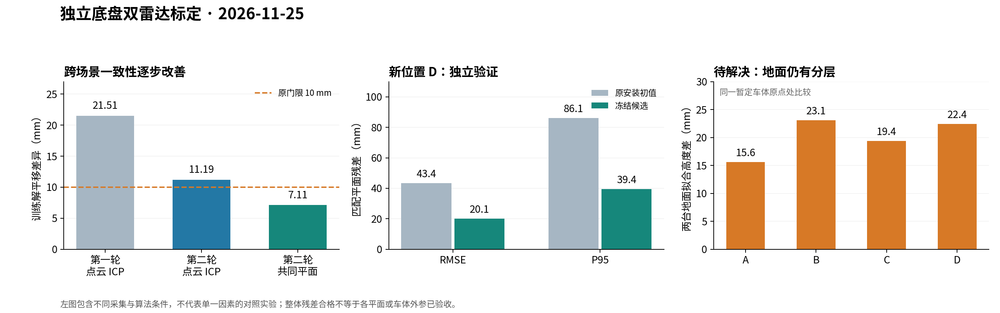
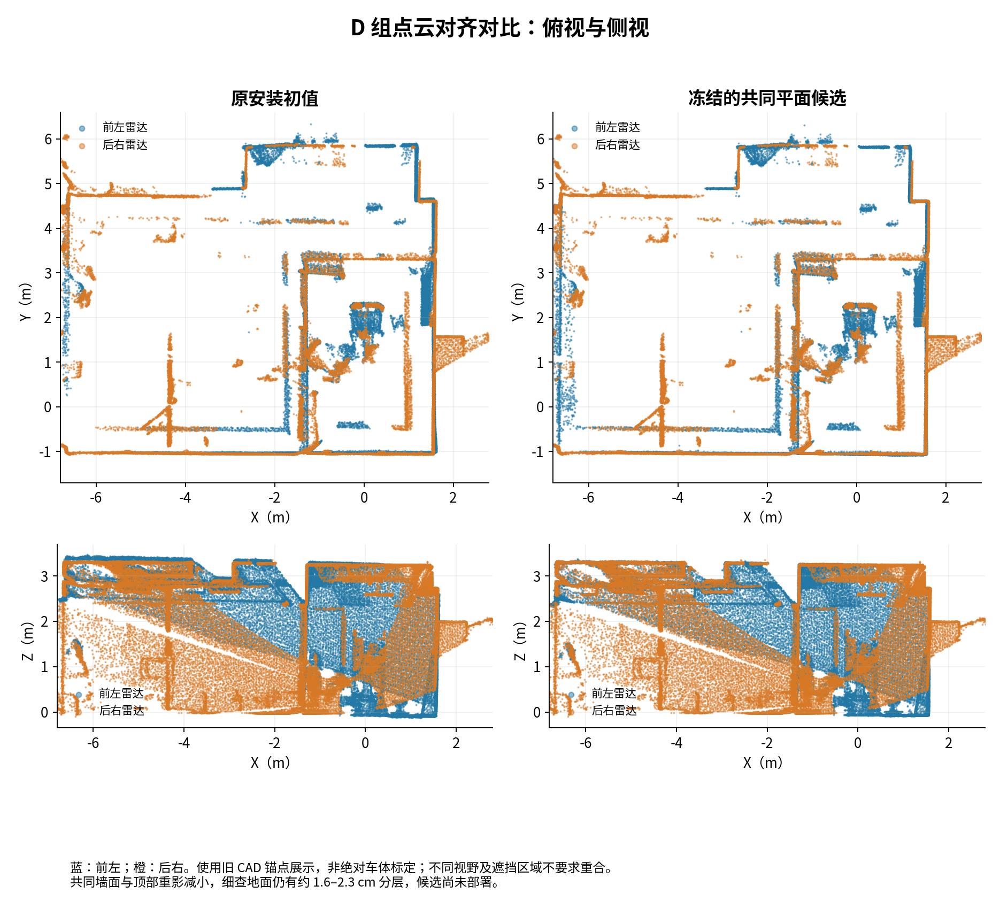

## 独立底盘双雷达标定与车体外参核对

**工作日期：2026年11月25日**

完成双 MID360S 雷达第二轮静止采集、相对外参求解及新位置独立验证。冻结候选在 D 组的匹配平面 RMSE 由 **43.41 mm 降至 20.14 mm，降低53.6%**；A/B共同平面独立解差异为 **7.11 mm / 0.211°**，满足既定一致性门限。进一步核对发现两台地面仍存在 **15.6–23.1 mm** 分层，车体绝对外参尚未完成验证，当前候选未部署。

**本周完成工作**

- 完成第二轮 A、B、B_repeat、C、D 共5组静止采集，每组每台雷达记录300帧点云、6000帧IMU的流统计，点云按每5帧抽取1帧保存。B_repeat用于原位重复性检查，与B独立解差异为0.395 mm / 0.0104°，不充当独立验证场景。
- 对比原点到平面ICP与共同大平面等权求解。原ICP第一、二轮训练解平移差异分别为21.51 mm、11.19 mm，均未通过10 mm门限；共同平面方法得到7.11 mm差异。训练采用两面墙与顶部平面，不强制墙面正交。
- 新方法形成候选后先记录哈希并冻结，再采新位置D验证；D不参与调参。完成点云对齐图审阅及地面专项核对，保留原算法拒绝报告。
- 完成采集、静止性检查、拟合、冻结候选验证脚本及操作手册整理，并同步到目标NUC，便于后续复用和追溯。

**关键验证数据**

| 指标 | 实测结果 | 判定或说明 |
|---|---:|---|
| A/B共同平面独立解平移差 | 7.11 mm | 满足≤10 mm |
| A/B共同平面独立解旋转差 | 0.211° | 满足≤0.3° |
| D组匹配平面RMSE | 43.41 → 20.14 mm | 候选满足≤25 mm |
| D组匹配平面绝对残差P95 | 86.11 → 39.44 mm | 候选满足≤50 mm |
| D组双向较少的匹配点数 | 21,008 | 满足≥1,500 |
| D组10 cm内双向较小覆盖比例 | 48.39% | 满足≥15% |
| A/B/C/D地面高度差 | 15.6 / 23.1 / 19.4 / 22.4 mm | 待解释与消除，不能由整体指标替代 |

*图1：训练一致性、同一D组上的初值/候选对比及地面残差。训练阶段采集与算法条件均有变化，不能把改善全部归因于某一个因素。*

*图2：蓝色为前左雷达，橙色为后右雷达。候选使共同墙面及顶部平面的重影减小；显示坐标借用旧CAD锚点，不代表绝对车体外参已经验收。*

**当前问题与结论边界**

整体相对配准指标已通过既定静止检查，但逐平面核对仍发现地面分层。单台点云估计光学原点离地高度：前左306.9–310.7 mm，后右303.4–304.8 mm；相对地面法线倾角均约25°。这些是几何估计，不是经尺具确认的车体位置或安装角。现阶段不能分别修改两台高度来消除地面差异，否则会改变已冻结的相对变换。

旧部署包CAD可作安装初值及显示参考，车体原点、支架尺寸和光学原点偏移仍需实物核对。采集保留历史同步告警0x04050002，静止窗口内按实时数据条件检查；静止几何资格不等于动态导航或PTP系统验收。本次未标定厂家内参，未修改运行外参，未启动自主导航。

**下一步计划**

核对旧CAD与实物的关键尺寸及坐标定义，以尺具或经确认的安装图确定后右参考雷达的车体锚点；补充共同地面的几何约束，查明残差来源。若据此调整算法或外参，重新冻结候选并采新位置独立验证；通过车体外参核对后，再进行静止融合与低速建图验证。

---

数据依据：`周报数据依据.json`记录报告来源；原始会话为`corner_20261125_01/02`，冻结候选为`common_planes_candidate_v1`。RMSE/P95为有效匹配点到局部平面的残差，不代表绝对定位精度、测距真值误差或外参精度置信区间。
