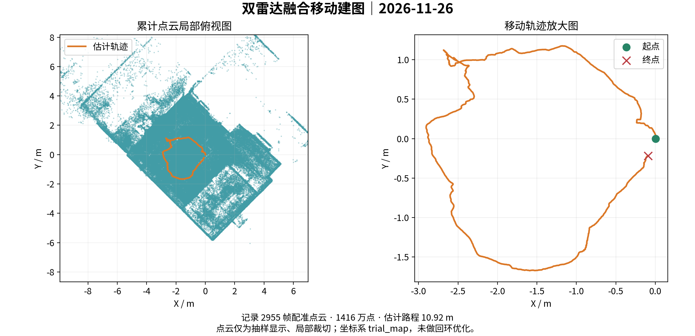

## 独立底盘双雷达融合与移动建图

**工作日期：2026年11月26日｜整理日期：11月27日**

完成双 MID360S 雷达经交换机接入 NUC，打通“相对外参融合—FAST-LIO 雷达/IMU里程计—点云配准—录包与地图导出”链路。通过静止检查后，完成一次低速手柄移动建图，运行约 **5.2分钟**、估计行驶 **10.92 m**，由操作员双扳机正常结束。已实现浏览器实时查看累计点云和轨迹，并导出约 **1416万点、227 MB** 的全时段配准点云地图。

- **融合与建图接入：**沿用冻结的双雷达相对外参候选，在独立试验配置中完成点云统一坐标与逐点时间适配，接入后右雷达IMU及FAST-LIO前端；本轮监督节点检查的融合帧均包含两台雷达，逐点时间有序。
- **运行问题处理：**定位到监督节点ROS IMU接收队列过短导致的缺口误报；同期录包IMU仍连续、原始包无对应丢失。扩大接收队列并新增时间戳过期检查，保留真实缺口保护，经锁定运动复测后完成本轮移动建图。此前PTP诊断告警根因仍未定论，不计作已解决。
- **成果留存：**保存原始双雷达点云、IMU、融合点云、配准结果、轨迹及控制日志，提供PCD导出脚本与实时俯视预览，支持后续离线回放与回环验证。

| 指标 | 本轮结果 |
|---|---:|
| 总运行时间 / 录包时长 | 311.11 s / 295.58 s |
| 融合点云接收帧数 | 3064 帧 |
| 全时段导出配准帧数 | 2955 帧，与录包计数一致 |
| 导出点数 / 文件大小 | 14,160,514 点 / 226.57 MB |
| 估计轨迹累计长度 | 10.92 m |
| 运行退出 | 操作员双扳机结束，无健康故障退出、无强制终止进程 |

*图：全时段配准点云的局部俯视投影及估计轨迹。仅图示作抽样和裁切，PCD导出没有额外抽帧；前端已有抽点、体素滤波和近场裁剪仍保留。融合帧与配准帧属于不同处理阶段，不以两者差值计算丢帧率。轨迹长度不是外部真值精度指标。*

**当前边界与下一步：**本轮验证了低速人工移动建图链路；SAM因子图后端及回环尚未开启，车体绝对外参、近场过滤与自主导航尚未验收。下一步用已有录包离线启用回环与因子图优化，对比地图重影、轨迹及回环约束，再推进已有地图定位和点到点导航。
